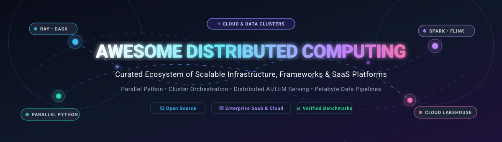

  

# ⚡ Awesome Distributed Computing 🌐

  <strong>A curated directory of top-tier distributed computing platforms, scalable Python frameworks, cluster orchestrators, and high-throughput data processing engines.</strong>

  
  
  
  
  
  
  

  <a href="#-sector-overview--market-dynamics">Sector Overview</a> •
  <a href="#-saashosted-platforms">SaaS Platforms</a> •
  <a href="#-open-source-github-projects">Open-Source Engines</a> •
  <a href="#-how-to-contribute">Contributing</a> •
  <a href="#-star-history">Star History</a> •
  <a href="#-support--sponsorship">Support</a>

---

## 📌 Introduction & Overview 🚀

Welcome to the **Awesome Distributed Computing** ecosystem repository! Whether scaling high-performance compute workloads from a single laptop to thousand-node cloud clusters or deploying distributed AI / LLM inference pipelines, this guide tracks industry-standard **enterprise SaaS platforms** and battle-tested **open-source frameworks**.

### 🔍 Key Areas Covered:
- 🐍 **Parallel Python & Accelerated DataFrames:** Scale Pandas and NumPy seamlessly with [Ray](https://github.com/ray-project/ray), [Dask](https://github.com/dask/dask), [Modin](https://github.com/modin-project/modin), and [Polars](https://github.com/pola-rs/polars).
- 🧠 **Distributed AI, LLM Serving & Deep Learning:** Multi-GPU and cluster scaling powered by [vLLM](https://github.com/vllm-project/vllm), [DeepSpeed](https://github.com/deepspeedai/DeepSpeed), and [Horovod](https://github.com/horovod/horovod).
- ⚙️ **Workflow Orchestration & Task Distribution:** Programmatic fault-tolerant DAG engines with [Apache Airflow](https://github.com/apache/airflow), [Celery](https://github.com/celery/celery), [Dagster](https://github.com/dagster-io/dagster), and [Flyte](https://github.com/flyteorg/flyte).
- 📊 **Petabyte-Scale Big Data & Federated SQL:** Massive distributed analytics engines including [Apache Spark](https://github.com/apache/spark), [Apache Flink](https://github.com/apache/flink), [Presto](https://github.com/prestodb/presto), and [Trino](https://github.com/trinodb/trino).
- ☁️ **Managed Cloud Lakehouses & Serverless Compute:** Turnkey enterprise infrastructure via [Databricks](https://www.databricks.com/), [Anyscale](https://www.anyscale.com/), [Coiled](https://www.coiled.io/), [Saturn Cloud](https://saturncloud.io/), and [Domino Data Lab](https://www.dominodatalab.com/).

---

## 📈 Sector Overview & Market Dynamics 🌐

The global distributed computing, cloud orchestration, and edge infrastructure market is estimated at **$25B–$35B** (expanding at an estimated **14%–22% CAGR** toward **$75B+** by the late 2020s), propelled by exponential demand for distributed LLM training/inference clusters, real-time edge processing, and multi-region data residency governance.

The sector is **moderately fragmented yet bimodal**: infrastructure-level execution and unified lakehouse storage exhibit a strong "winner-take-most" concentration dominated by hyperscalers and scale leaders like Databricks, while the workflow orchestration, distributed task queuing, and specialized tensor acceleration layers remain highly fragmented across innovative startups and thriving open-source communities.

---

## 🏢 SaaS/Hosted Platforms ☁️

The following table benchmarks prominent SaaS platforms and managed cloud offerings for distributed computing, sorted descending by company scale (valuation / annual revenue).

| 🏢 Platform | 💰 Company Scale (Valuation / Revenue) | 📝 Description | 🏷️ Starting Pricing Tier | 🎁 Free Tier / Trial Limits | 🎯 Best For |
| :--- | :--- | :--- | :--- | :--- | :--- |
| [**Databricks**](https://www.databricks.com/) | **$190B Valuation** (~$7B+ ARR) | Unified Lakehouse platform built on Apache Spark with managed Delta Lake, MLflow, serverless compute, and Unity Catalog governance. | **$0.07 to $0.15 / DBU** (Jobs Compute on standard/light tiers; interactive compute starts at ~$0.40–$0.55/DBU) | **14-day free trial** with **$400 in platform credits** (underlying cloud infrastructure billed separately) | Enterprise-scale batch/streaming ETL, Spark workflows, and lakehouse governance |
| [**Anyscale**](https://www.anyscale.com/) | **$1.65B Valuation** (Acquired by Nscale; high-growth ARR) | Production distributed AI and Ray management platform for distributed model training, fine-tuning, and ultra-low-latency LLM serving. | **Usage-based compute** starting at standard Ray instance rates; Enterprise plans via custom quote | **Free Tier** with **$100 developer signup credits** for running lightweight distributed Ray jobs | Teams committed to Ray scaling distributed AI, RLlib, and LLM inference pipelines |
| [**Domino Data Lab**](https://www.dominodatalab.com/) | **~$500M+ Valuation** ($228M funded; ~$25M–$43M ARR) | Enterprise MLOps platform for developing, scaling, and governing distributed AI across multi-cloud and on-prem clusters. | **Custom contract quote** (Baseline platform editions start at ~$50,000/year for team tiers) | **Custom trial only** (Enterprise pilot / Sales-coordinated PoC environment; no public self-serve free plan) | Regulated enterprise organizations needing audited, governed distributed MLOps |
| [**Coiled**](https://www.coiled.io/) | **~$26M Funded** (Series A; ~$2M ARR) | Serverless deployment platform for scaling Python and Dask workloads directly inside customer VPCs with zero idle infrastructure. | **Basic Plan: $100/month** (includes 2 seats, 1 workspace, and $100 monthly usage allowance) | **Free-for-ever tier**: **$25 of compute usage per month** (1 seat, 1 workspace; hard cap with zero overages) | Data science teams wanting serverless Dask clusters inside their own AWS/GCP/Azure cloud |
| [**Saturn Cloud**](https://saturncloud.io/) | **~$25M–$50M Valuation** ($4M funded; ~$5M–$10M ARR) | Data science platform with high-memory instances, multi-node Dask clusters, and managed GPU workspaces. | **Hosted Pro**: Pay-as-you-go hourly compute (CPUs & GPUs) + storage at ~$0.20/GB/month | **Hosted Free Plan**: **150 hours of compute per month** (up to 64GB RAM & GPU access, no credit card required) | Individuals and teams looking for hosted Dask environments and Jupyter notebooks |

---

## 💻 Open-Source GitHub Projects 🛠️

The following open-source frameworks and libraries power modern distributed computing workloads. Projects are sorted descending by GitHub star count.

| 📦 Project | ⭐ Stars | 📜 License | 💡 Core Focus & Description |
| :--- | :---: | :--- | :--- |
| [**vLLM**](https://github.com/vllm-project/vllm) |  | Apache-2.0 | High-throughput, memory-efficient distributed LLM serving and inference engine utilizing PagedAttention across distributed multi-GPU clusters. |
| [**Apache Airflow**](https://github.com/apache/airflow) |  | Apache-2.0 | Industry-standard platform to programmatically author, schedule, and orchestrate complex distributed computational data workflows. |
| [**Apache Spark**](https://github.com/apache/spark) |  | Apache-2.0 | Unified analytics engine for petabyte-scale distributed data processing, featuring resilient distributed datasets (RDDs), Spark SQL, and streaming. |
| [**Ray**](https://github.com/ray-project/ray) |  | Apache-2.0 | General-purpose distributed compute execution framework powering modern distributed AI training (Ray Train), tuning, and serving across clusters. |
| [**DeepSpeed**](https://github.com/deepspeedai/DeepSpeed) |  | Apache-2.0 | Extreme-scale distributed deep learning optimization library implementing ZeRO (Zero Redundancy Optimizer) for models with hundreds of billions of parameters. |
| [**Polars**](https://github.com/pola-rs/polars) |  | MIT | Blazingly fast multi-threaded and distributed dataframe library written in Rust with Apache Arrow memory model for out-of-core and parallel execution. |
| [**Celery**](https://github.com/celery/celery) |  | BSD-3-Clause | Distributed asynchronous task queue and job processing system for executing millions of concurrent tasks across worker pools. |
| [**Apache Flink**](https://github.com/apache/flink) |  | Apache-2.0 | Distributed stateful processing engine over data streams and batch workloads with high-throughput and exactly-once processing guarantees. |
| [**Presto**](https://github.com/prestodb/presto) |  | Apache-2.0 | Distributed SQL query engine designed for running interactive analytic queries at petabyte scale against heterogeneous distributed data sources. |
| [**Dagster**](https://github.com/dagster-io/dagster) |  | Apache-2.0 | Cloud-native data orchestrator for distributed data assets, supporting fine-grained data lineages and distributed computation steps. |
| [**Horovod**](https://github.com/horovod/horovod) |  | Apache-2.0 | Distributed deep learning training framework utilizing ring-allreduce architecture for TensorFlow, Keras, PyTorch, and Apache MXNet. |
| [**Dask**](https://github.com/dask/dask) |  | BSD-3-Clause | Flexible parallel and distributed computing library native to Python, scaling NumPy, Pandas, and Scikit-Learn workflows from laptops to multi-node clusters. |
| [**Trino**](https://github.com/trinodb/trino) |  | Apache-2.0 | Fast distributed SQL query engine for big data analytics running ad-hoc federated queries over object stores and distributed databases. |
| [**Modin**](https://github.com/modin-project/modin) |  | Apache-2.0 | Drop-in acceleration for Pandas workflows across all available CPU cores or clusters using Ray, Dask, or MPI backends with zero code refactoring. |
| [**RAPIDS cuDF**](https://github.com/rapidsai/cudf) |  | Apache-2.0 | GPU-accelerated DataFrame library providing Pandas-like APIs for highly parallelized distributed data manipulation with multi-GPU scaling. |
| [**Flyte**](https://github.com/flyteorg/flyte) |  | Apache-2.0 | Production-grade, Kubernetes-native workflow automation platform for mission-critical distributed ML and computational data processing. |
| [**Mars**](https://github.com/mars-project/mars) |  | Apache-2.0 | Tensor-based unified framework for large-scale distributed computation, tiling multi-dimensional tensors and dataframes across heterogeneous hardware. |
| [**Dask-ML**](https://github.com/dask/dask-ml) |  | BSD-3-Clause | Distributed Scikit-Learn wrapper providing scalable model training, ensemble evaluation, and hyperparameter search across Dask clusters. |
| [**Bodo**](https://github.com/bodo-ai/Bodo) |  | Apache-2.0 | High-performance auto-parallelizing compiler engine based on MPI/HPC architecture, delivering near-C++ speed for distributed Python data processing. |

---

## 🤝 How to Contribute 📖

Contributions are very welcome! To add or update an entry:

1. 🍴 Fork the repository.
2. ✍️ Add/edit entries in [README.md](file:///C:/Users/ishan/Documents/Projects/Awesome-Distributed-Computing/README.md) (maintain alphabetical or designated sorting and badge style).
3. 📋 Include: project name, official website/repo link, verified starting tier pricing, free limits, and a concise technical description.
4. 🚀 Submit a Pull Request with a clear description of the additions or updates.

🌟 **Star the repo** if you find this curated resource helpful!

---

## 📊 Star History

---

## 💖 Support & Sponsorship ☕

Thank you so much for taking the time to explore and support the **Awesome Distributed Computing** collection! 🎉

If this repository helped you discover tools, architect your distributed data stack, or accelerate your AI workflows, please consider supporting this open-source effort:

- ⭐ **Star this repository** to help others discover it.
- 🍴 **Fork and share** it with your fellow engineers, data scientists, and DevOps colleagues.
- 💬 Join our discussions on [Discord](https://discord.gg/jc4xtF58Ve) and connect with the community.
- ☕ **Buy a coffee / Sponsor the project:** Support ongoing maintenance, research, and curation directly via the [GitHub Sponsors Dashboard](https://github.com/sponsors/ishandutta2007).

---

## ⚖️ Disclaimer 🛡️

- This repository is a **community-curated index** — provided for informational and educational purposes without endorsement.
- Distributed computing systems processing enterprise data must satisfy applicable privacy and security regulations (e.g., GDPR, CCPA, SOC2) and establish strict role-based access controls.
- **The "framework vs. managed platform" dynamic:** Open-source frameworks (Dask, Ray, Spark) deliver complete flexibility with self-hosted operational responsibility; managed platforms (Databricks, Anyscale, Coiled) reduce operational overhead through consumption-based managed services. Many mature production architectures leverage both.

---

  <strong>Built with ❤️ for data scientists, cloud architects, and distributed systems engineers worldwide.</strong> 
  Let's make Distributed Computing open, scalable, and accessible to all.

